# How To: Portals Installieren

## 1. Neues Projekt anlegen
- Wähle eine aktuelle Unity-Version. Version **6000.2.10f** ist getestet.  
- Wähle außerdem das **Universal 3D Template**.  
- Alternativ kannst du auch ein bestehendes Projekt verwenden.  

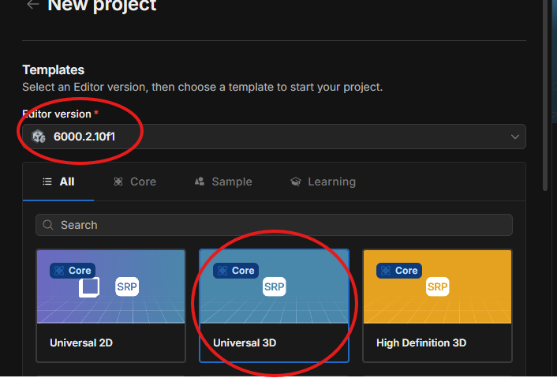

---

## 2. Benötigte Packages installieren
1. Öffne den **Package Manager** unter `Window → Package Manager`.  

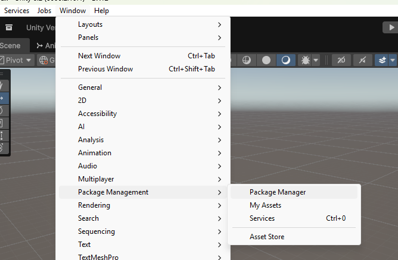

2. Installiere die folgenden Packages:
   - **OpenXR** – Version **1.15.1** ist getestet.  
     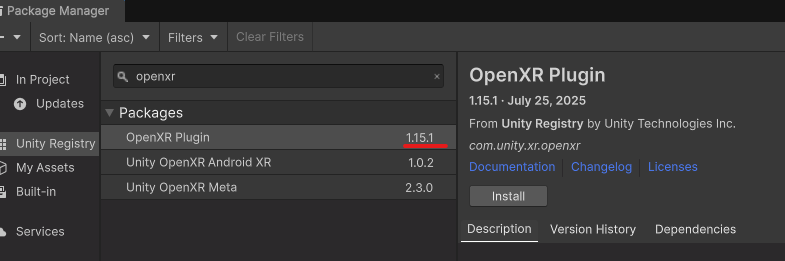
   - **XR Interaction Toolkit** – Version **3.2.2** ist getestet.  
     
   - **XR Toolkit Starter Assets** – importiere die Starter Assets.  
     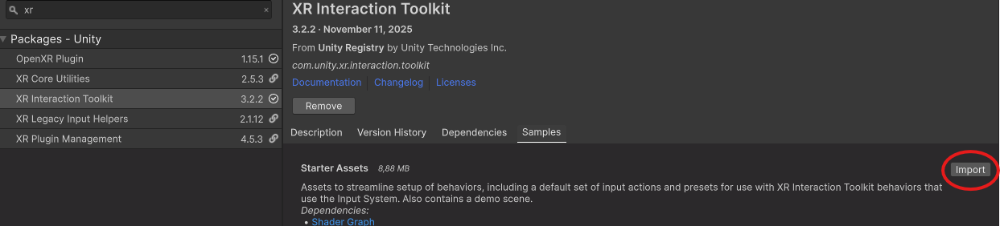

---

## 3. Bestehende Validation Issues beheben
- Gehe zu den **Project Settings → Project Validation** und behebe vorhandene Issues.  
- Meist reicht ein Klick auf **"Fix All"**.  

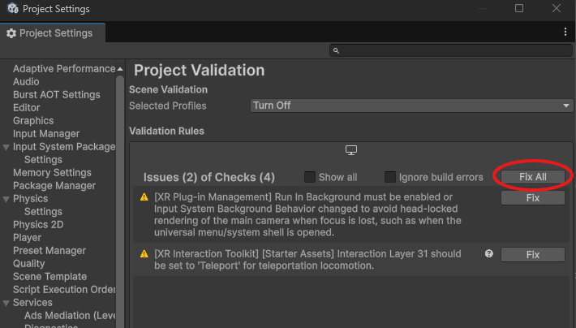

---

## 4. Portals Package importieren
- Lade das `Portals.unitypackage` herunter und doppelklicke es zum Importieren.  
- Importiere **alle Dateien**.  

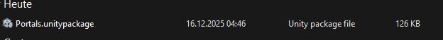

---

## 5. Überprüfen, ob die Layer korrekt angelegt wurden
- Prüfe die **Layer Collision Matrix** unter `Physics → Settings`.  
- Stelle sicher, dass der Layer **PortalScreen** enthalten ist und keine Kollision mit anderen Layern hat.  
- Achtung: Manchmal wird die Layer-Matrix komplett überschrieben.  
- Wenn kein Haken zwischen irgendwelchen Layern gesetzt ist, bitte korrigieren.  
- Die Matrix sollte wie im Bild aussehen:  

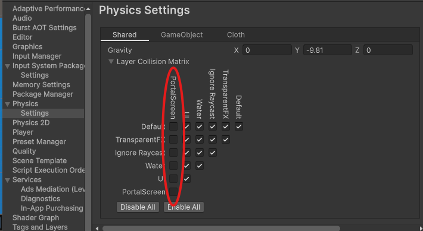

---

## 6. Demo-Scene starten und testen
- Starte die **Demo Scene** und überprüfe, ob alles funktioniert.

---

# How To: Eigenes Portal erstellen

## 1. Portal-Objekt der Szene hinzufügen
- Füge beispielsweise einen Würfel oder ein eigenes Objekt der Szene hinzu.  
- ⚠️ **Achtung:** Die Teleportationsebene orientiert sich immer an der **lokalen Z-Achse** des Objekts.  
  Daher sollte die Z-Achse die **flache Achse** des Objekts sein. 

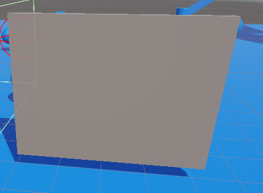

---

## 2. Portal-Script hinzufügen
- Füge dem Objekt das **Portal-Script** hinzu.  

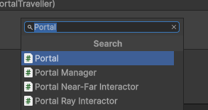

- Achte darauf:  
  - Der Haken bei `Use Mesh As Screen` ist gesetzt.  
  - Das Feld `Screen Material` enthält das Material **Portal Screen**.  

- Alternativ können auch komplexere Objekte angelegt werden.  
  Orientiere dich hierbei an dem **Demo-Portal**.

---

## 3. Collider anpassen
- Passe den **Collider** des Objekts so an, dass ein großzügiger Bereich vor und hinter dem Portal eingeschlossen wird.  
- Dieser Bereich dient als **Trigger**, um durchquerende Objekte zu erfassen.  

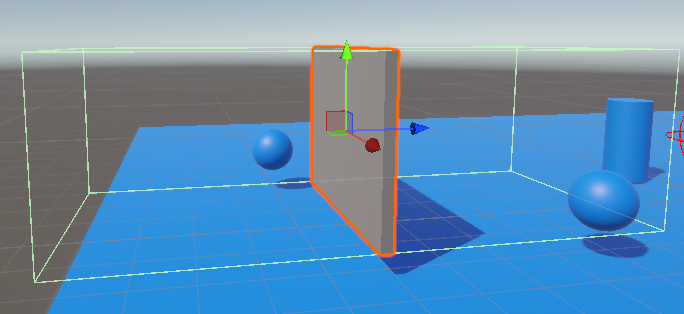

---

# How To: Eigenen Portal Traveller erstellen

## 1. Objekt der Szene hinzufügen
- Füge beispielsweise einen Würfel oder ein eigenes Objekt der Szene hinzu.

---

## 2. Grab Portal Traveller-Script hinzufügen
- Füge dem Objekt das **Grab Portal Traveller-Script** hinzu.  

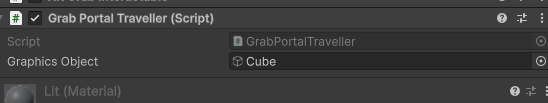

- Achte darauf:  
  - Das dem `Graphics Object` das entsrechende Objekt zugewiesen wurde.