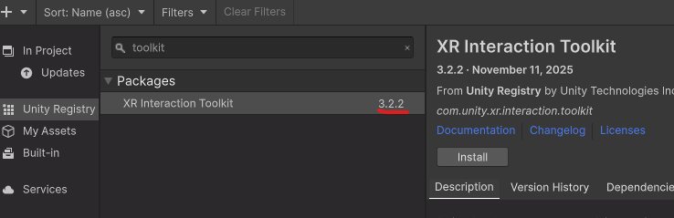
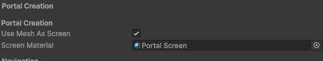
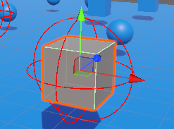

# How To: LinkSpace Installieren

## 1. Neues Projekt anlegen
- Waehle eine aktuelle Unity-Version. Version **6000.3.5f** ist getestet.
- Waehle ausserdem das **Universal 3D Template**.
- Alternativ kannst du auch ein bestehendes Projekt verwenden.

---

## 2. XR Plugin Management

- Oeffne `Edit -> Project Settings -> XR Plugin Management`.
- Klicke **Install XR Plugin Management**.
- Aktiviere OpenXR als Plug-in Provider.
- Klicke **Fix All** unter `XR Plug-in Management -> Project Validation`.
- Aktiviere unter `XR Plug-in Management -> OpenXR -> Enabled Interaction Profiles` das **Oculus Touch Controller Profile**.

## 3. XR Interaction Toolkit
1. Oeffne den **Package Manager** unter `Window -> Package Manager`.

2. Installiere die folgenden Packages:
   - **XR Interaction Toolkit** - Version **3.3.1** ist getestet.
     
   - **XR Toolkit Starter Assets** - importiere die Starter Assets.
     

---

## 4. Bestehende Validation Issues beheben
- Gehe zu `Project Settings -> Project Validation` und behebe vorhandene Issues.
- Meist reicht ein Klick auf **Fix All**.

---

## 5. LinkSpace Package importieren
- Lade das `LinkSpace.unitypackage` herunter und doppelklicke es zum Importieren.
- Importiere **alle Dateien**.

---

## 6. Layer pruefen
- Pruefe die **Layer Collision Matrix** unter `Physics -> Settings`.
- Stelle sicher, dass der Layer **SpatialViewScreen** enthalten ist und keine Kollision mit anderen Layern hat.
- Achtung: Manchmal wird die Layer-Matrix komplett ueberschrieben.
- Wenn kein Haken zwischen irgendwelchen Layern gesetzt ist, bitte korrigieren.
- Wenn der Layer **SpatialViewScreen** nicht existiert, lege ihn unter `Tags and Layers` auf `User Layer 6` an.
- Die Matrix sollte am Ende wie im Bild aussehen:

---

## 7. Szene vorbereiten

- Oeffne `Assets/LinkSpace/Demo/SampleScene.unity`.
- Klicke auf ein GameObject mit `SpatialView`-Komponente und verlinke eine andere Spatial View als `Linked View`.

---

## 8. Demo-Scene starten und testen
- Starte die **Demo Scene** und pruefe, ob alles funktioniert.

---

# How To: Eigene Spatial View erstellen

## 1. Spatial-View-Objekt der Szene hinzufuegen
- Fuege beispielsweise einen Wuerfel oder ein eigenes Objekt der Szene hinzu.
- **Achtung:** Die Teleportationsebene orientiert sich immer an der **lokalen Z-Achse** des Objekts.
  Daher sollte die Z-Achse die **flache Achse** des Objekts sein.

---

## 2. SpatialView-Script hinzufuegen
- Fuege dem Objekt das **SpatialView-Script** hinzu.

- Achte darauf:
  - Der Haken bei `Use Mesh As Screen` ist gesetzt.
  - Das Feld `Screen Material` enthaelt das Material **Spatial View Screen**.

- Alternativ koennen auch komplexere Objekte angelegt werden.
  Orientiere dich hierbei an der **Demo Spatial View**.

---

## 3. Collider anpassen
- Passe den **Collider** des Objekts so an, dass ein grosszuegiger Bereich vor und hinter der Spatial View eingeschlossen wird.
- Dieser Bereich dient als **Trigger**, um durchquerende Objekte zu erfassen.

---

# How To: Eigenen Spatial Traveller erstellen

## 1. Objekt der Szene hinzufuegen
- Fuege beispielsweise einen Wuerfel oder ein eigenes Objekt der Szene hinzu.

---

## 2. GrabSpatialTraveller-Script hinzufuegen
- Fuege dem Objekt das **GrabSpatialTraveller-Script** hinzu.

- Achte darauf:
  - Dem Feld `Graphics Object` muss das entsprechende Objekt zugewiesen sein.

# Steuerung - Meta Quest 3

Dieses Projekt ist fuer die Nutzung mit der **Meta Quest 3** ausgelegt.
Die Eingaben sind fest auf die Controller-Belegung abgestimmt.

---

### Bewegung & Ansicht

| Eingabe | Funktion |
|--------|----------|
| Linker Joystick | Spielerbewegung (vorwaerts, rueckwaerts, seitwaerts) |
| Rechter Joystick links/rechts | Umschauen in festen 45-Grad-Schritten (Snap Turn) |
| Rechter Joystick nach vorne druecken | Ray-Teleport |

> Das Umschauen erfolgt bewusst ruckartig (Snap Turn), um Motion Sickness zu reduzieren.

---

### Spatial-View-Interaktionen

| Eingabe | Funktion |
|--------|----------|
| A-Button | Spatial View platzieren |
| B-Button | Spatial View zerstoeren |
| Y-Button | Ausrichtung der Spatial View aendern |
| Rechter Trigger | Spatial Views linken |
| Rechter Grip (Grab) | Spatial View greifen und verschieben |

---

### Objekt-Interaktionen

| Eingabe | Funktion |
|--------|----------|
| X-Button | Wuerfel spawnen |
| Trigger (bei greifbaren Objekten) | Objekte greifen / halten |

---

### Hinweise zur Nutzung

- Spatial Views koennen nach dem Platzieren weiterhin **verschoben** werden (Grip halten).
- Der Ray-Teleport funktioniert unabhaengig von den Spatial Views und dient zur normalen Fortbewegung.
- Gespawnte Wuerfel besitzen Traveller-Logik und koennen durch Spatial Views bewegt werden.
